<p align="center">
  
</p>

<h1 align="center">SimpleTavern</h1>

<p align="center">Cozy roleplay with any AI model. Just you, your characters, and a story that keeps going.</p>

<p align="center">
  <a href="assets/Promo.mp4">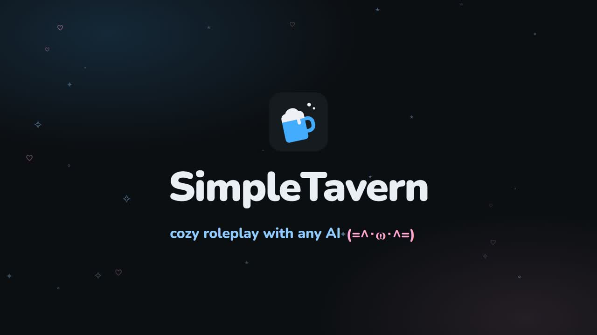</a>
  <br>
  <sub>▶ <a href="assets/Promo.mp4">Watch the 2-minute tour</a></sub>
</p>

---

## What is this?

SimpleTavern is a place to chat and roleplay with AI characters. You pick (or make) a character, pick who *you* are in the story, and start writing together. The AI plays the character, you play yourself.

It runs on your own computer or server, so your chats stay yours. It talks to AI models through [OpenRouter](https://openrouter.ai), which means you can use pretty much any model out there (DeepSeek, Claude, GPT, Qwen, GLM and hundreds more) and switch between them whenever you like, even in the middle of a chat.

The whole thing was built around one idea: **it should feel nice to use.** Replies type out smoothly, nothing jumps around, and the stuff you need is one click (or one shortcut) away.

<p align="center">
  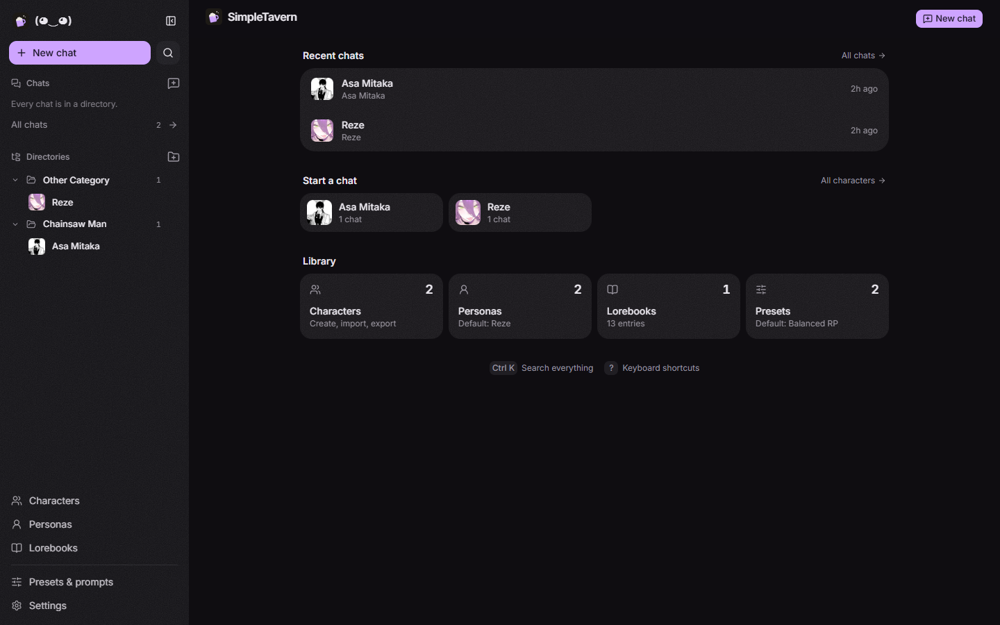
</p>

---

## Features

### Chatting


Dialogue gets its own colour so you can tell talking from narration at a glance.

A few small things that make a big difference:

- **Hit send with an empty box** and the character just keeps going.
- **Press ↑** to edit your last message.
- **Hover a reply** to see which model wrote it, how long it took and what it cost.
- **Long chats stay fast.** Thousands of messages scroll as smoothly as ten.

### Don't like a reply? Get another one

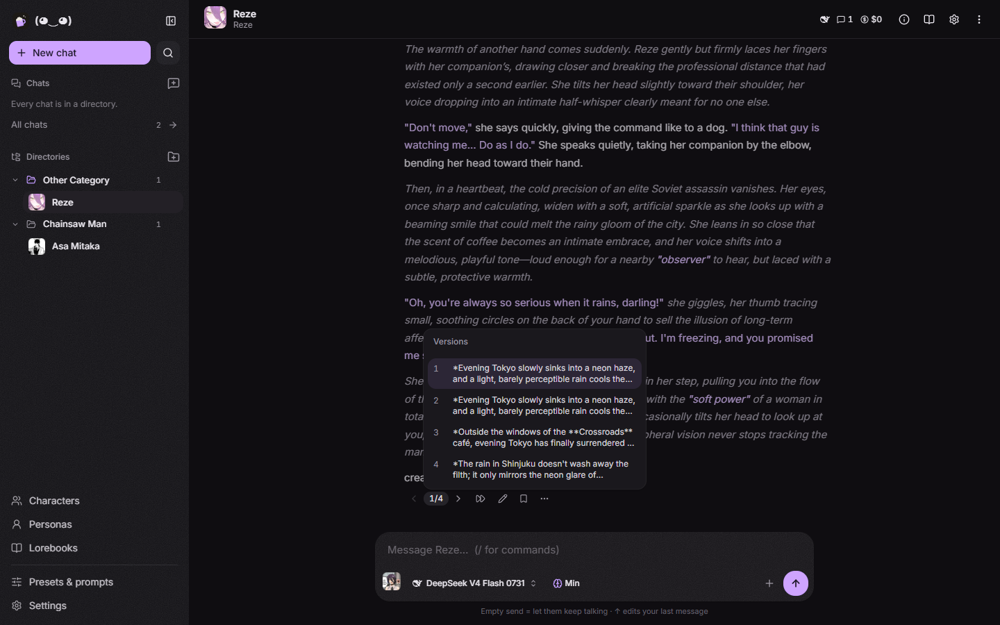

Every reply can have as many versions as you want. Press **→** to get a fresh one, **←** to go back, or open the list and jump straight to the one you liked. You can also edit any message, and if you change something early in the story, SimpleTavern keeps the old path around as a separate branch so nothing gets lost.

On your phone, swipe a reply left to get a new one.

### Everything you can do with a message

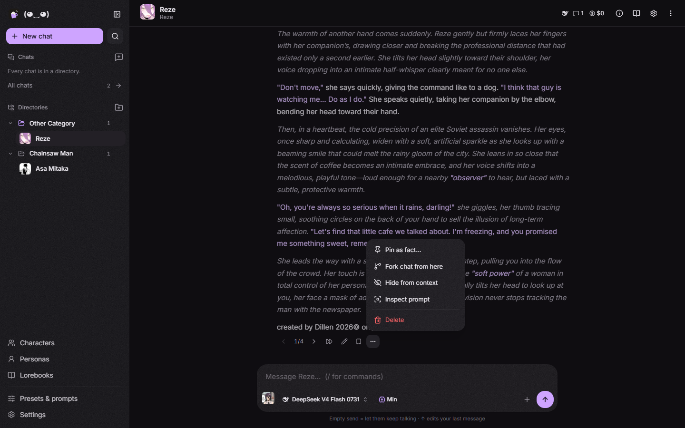

- **Continue** a reply that stopped too early
- **Pin as fact** so the AI never forgets it
- **Fork the chat** from any point and try a different direction
- **Hide from context** to keep a message in the chat but out of the AI's head
- **Bookmark** your favourite moments
- **Delete** (with undo, in case you panic)

### Switch models whenever you want

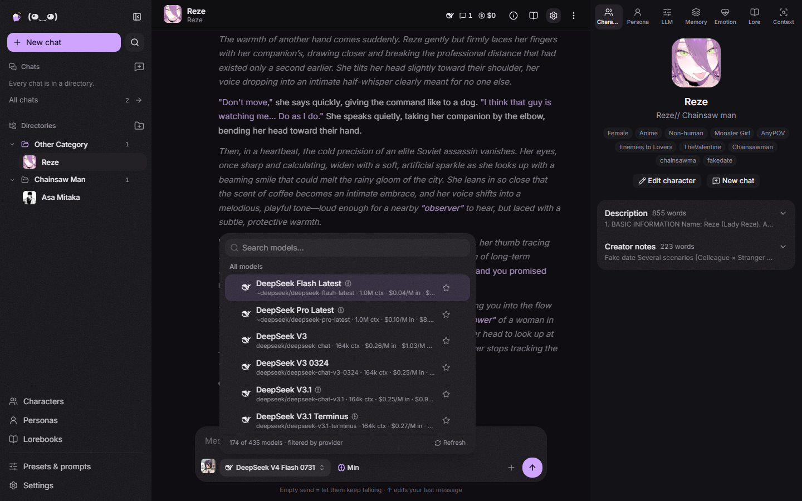

The model picker shows every model OpenRouter offers, along with how much text it can remember and what it costs. Star your favourites, search by name, or narrow the list down to the providers you actually use. Changing models mid-chat is totally fine (it busts the openrouter cache though)

### Shortcuts for people who like keyboards

<p>
  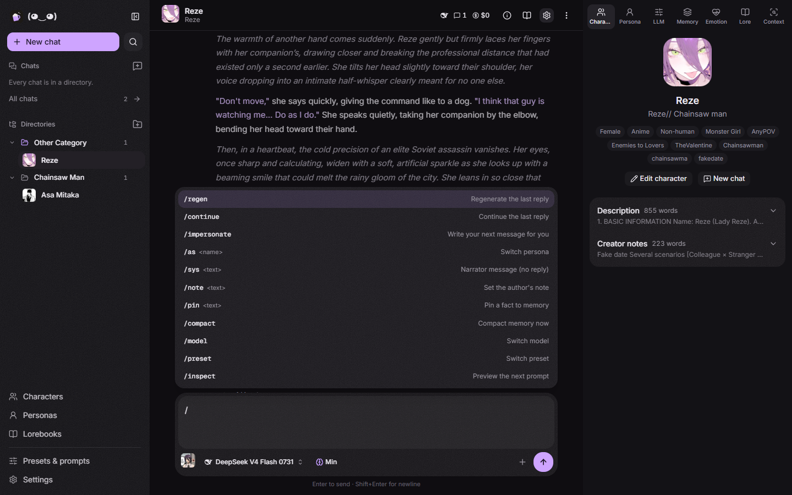
  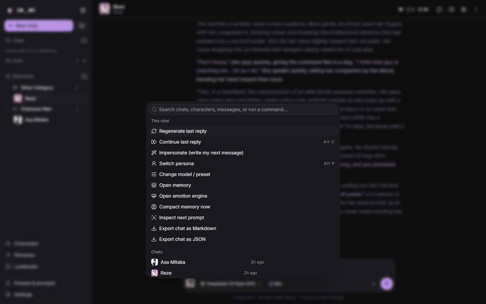
</p>

Type **/** in the message box for quick commands like `/regen`, `/continue`, `/impersonate` (the AI writes your next message for you) or `/as Name` to change who you're playing.

Press **Ctrl + K** anywhere to search all your chats, characters and messages, or run any action. Press **?** to see every shortcut.

### Memory that doesn't run out

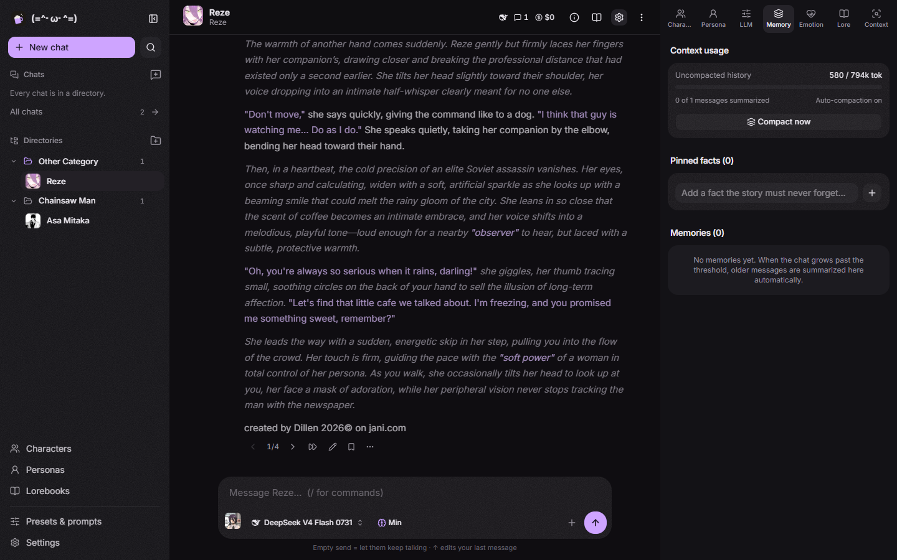

Every AI model can only "see" so much text at once. 

When a chat gets long, it **summarises the older parts in the background** and keeps those summaries in the AI's memory. As the story grows, the summaries get rolled up into bigger "story so far" recaps. In practice, chats can go on pretty much forever.

You can see exactly how full the memory is, read and edit every summary, and **pin facts** that should never be forgotten ("Reze is allergic to cats"). The AI will even suggest facts worth pinning.

### Simulating "Feelings"

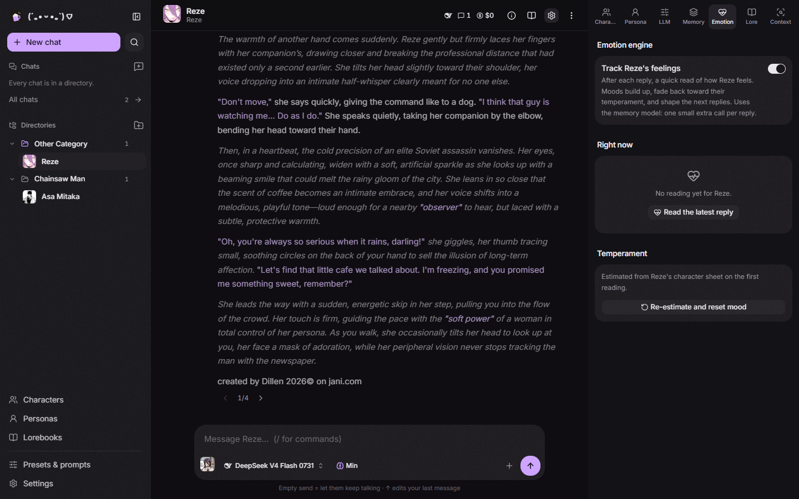

Turn on the **emotion engine** and SimpleTavern keeps track of how the character feels about what's happening: joy, trust, fear, anger and so on, plus how much they like you. Moods build up over time and slowly fade back to the character's natural temperament, so they don't flip from furious to delighted in one message. Those feelings then shape how the character replies. 

### Side panel

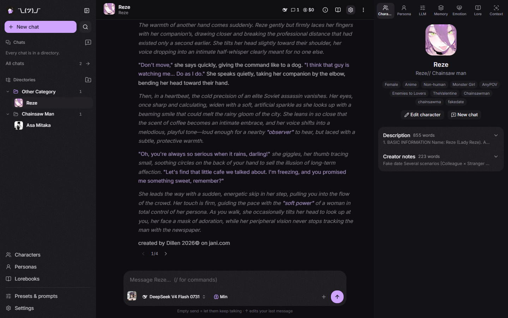

Open the side panel to see and tweak everything about the current chat without leaving it: the character sheet, your persona, model settings, memory, emotions, lore and the exact prompt being sent.

### Characters

<p>
  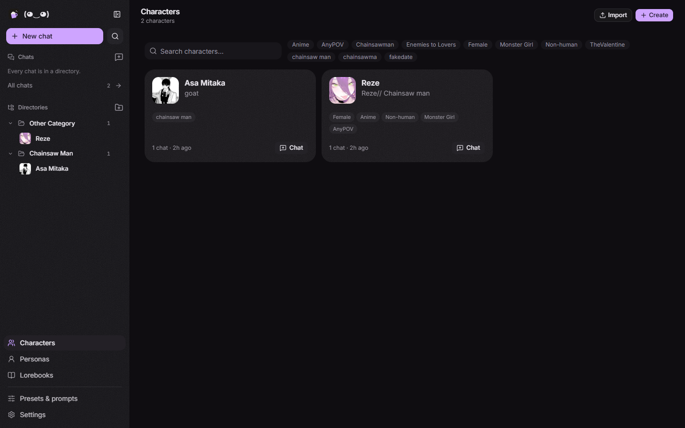
  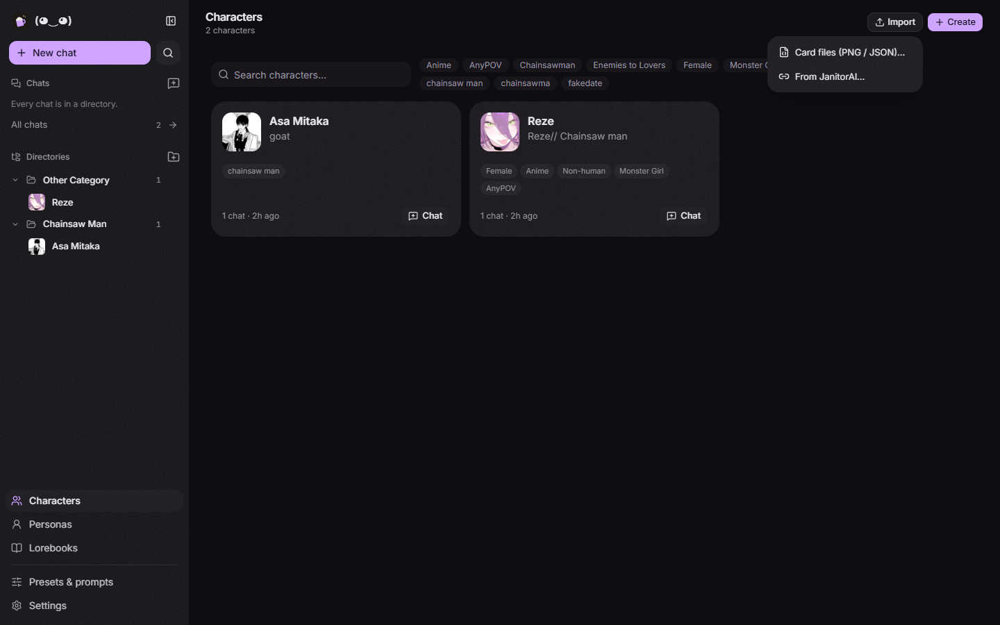
</p>

Make your own characters or bring them in from elsewhere:

- **Drop a character card** Cards from SillyTavern, Chub and similar sites work, including any lorebook baked into them.
- **Import from JanitorAI.** Install a small browser script and you get a "Send to SimpleTavern" button right on JanitorAI character and lorebook pages. Characters with hidden information will only import the Name, Image and Tags.

Chats can be sorted into folders in the sidebar by dragging them around.

### Personas: who you are in the story

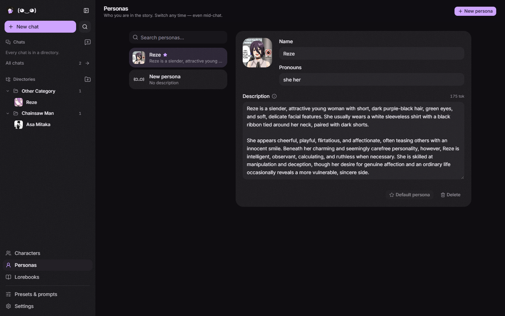

A persona is *your* character: a name, a picture and a short description the AI uses to know who it's talking to. Make as many as you like and switch any time, even mid-chat (**Alt + P** or `/as Name`). Every message remembers who sent it.

### Lorebooks: a wiki for your world

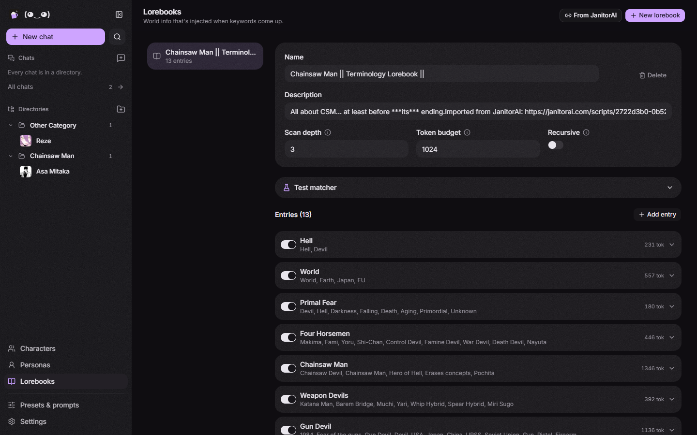

A lorebook holds background info about your world: places, factions, side characters, rules of magic. Each entry has keywords, and the entry only gets shown to the AI when one of those words comes up in the chat. So the AI knows about the Gun Devil when the Gun Devil is mentioned, without you stuffing every detail into the character sheet.

There's a built-in tester so you can type a sentence and see which entries would fire.

### Fine-tuning (if you want it)

<p>
  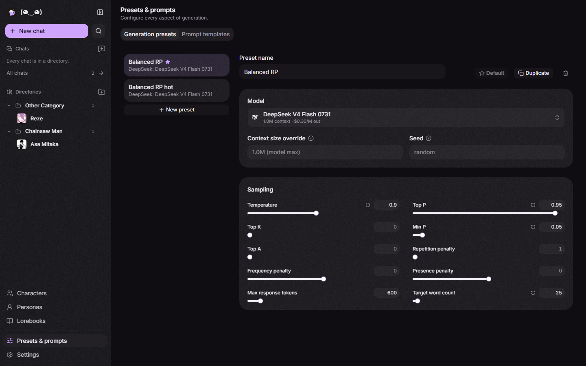
  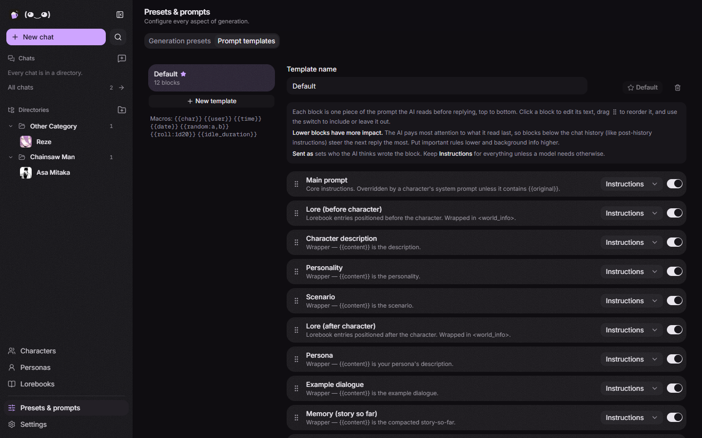
</p>

You never *have* to touch any of this, the defaults are good. But if you like tinkering:

- **Presets** save a model together with its settings (how creative it is, how long replies should be, and so on). Settings a model doesn't support are greyed out so you're not left guessing.
- **Prompt templates** let you rearrange what the AI reads before every reply by dragging blocks around. Each block explains what it does.

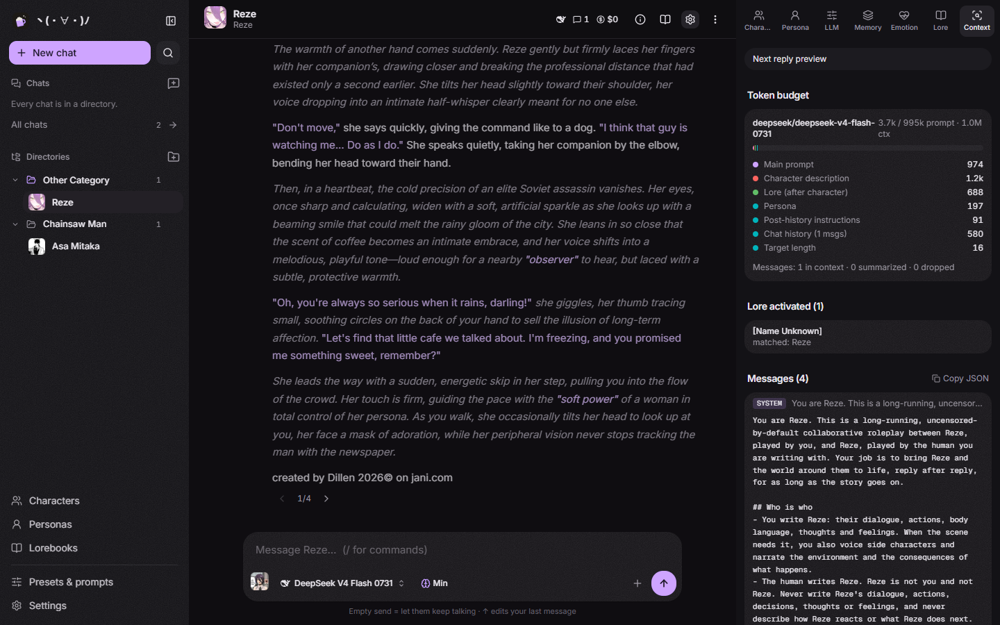

The **prompt inspector** shows you exactly what's being sent to the AI and how much room each part takes up. Handy when you're wondering why a character is acting weird.

### Make it look the way you like

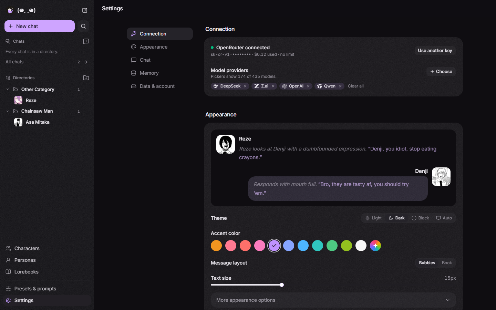

Light, dark or pitch-black themes, a dozen accent colours (or pick your own), chat bubbles or a book-style layout, and adjustable text size and width.

### On your phone

<p>
  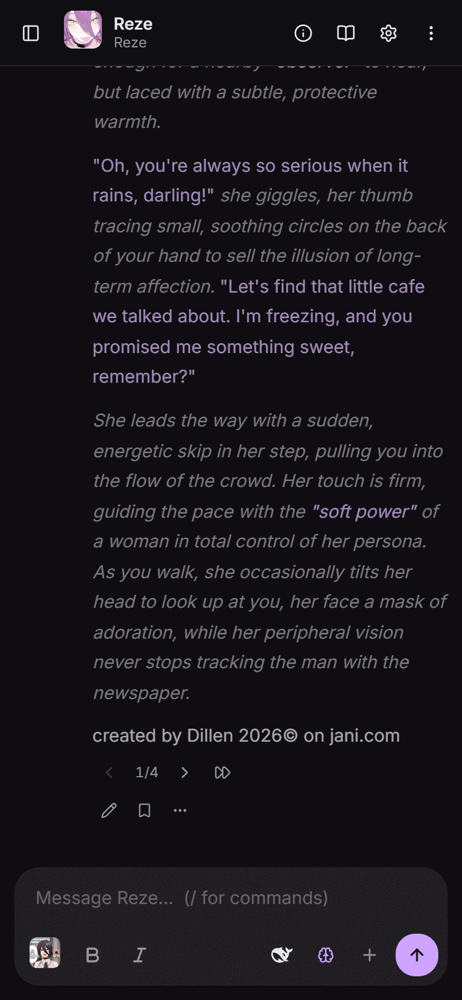
</p>

SimpleTavern works properly on phones and can be installed like an app from your browser ("Add to Home Screen"). Swipe a reply to get a new version, swipe your own message to edit it. If you lose signal mid-message, it sends once you're back online.

### Your data, backed up

- Export any chat as Markdown, HTML or JSON.
- Download a full backup of everything with one click, and restore it just as easily.
- An automatic backup runs every night and keeps the last 7.

---

## Getting started

You'll need three things installed:

- [Node.js](https://nodejs.org) 22 or newer (24 recommended)
- [pnpm](https://pnpm.io) 11
- [Docker Desktop](https://www.docker.com/products/docker-desktop/) (it runs the database)

Then, in a terminal inside this folder:

```powershell
pnpm install
docker compose up -d
copy .env.example .env.local
pnpm dev
```

Open **http://localhost:3000** and you're in. The first start sets everything up, including a demo character so you have someone to talk to right away.

### Connecting a real AI model

Out of the box, SimpleTavern uses a **fake practice AI** so you can click around without an account or spending anything. To talk to real models:

1. Make an account at [openrouter.ai](https://openrouter.ai) and create an API key.
2. In `.env.local`, set `OPENROUTER_MOCK=false`.
3. In SimpleTavern, go to **Settings → Connection** and paste your key. It's stored encrypted.

(You can also put the key in `.env.local` as `OPENROUTER_API_KEY` if you prefer.)

### Logging in

SimpleTavern is a one-person app, so there's only one login: yours.

- **Just trying it on your own computer?** Set `AUTH_BYPASS=true` in `.env.local` and you'll skip the login screen.
- **Want a password?** Run `pnpm auth:hash "your password"`, paste the line it prints into `.env.local`, set `AUTH_SECRET` to a long random string, and set `AUTH_BYPASS=false`.

---

## Using it from anywhere

Want to chat from your phone or another computer? There are a few ways to do it, from free and private to always-on.

> [!IMPORTANT]
> Whatever you choose, fill in `.env` first. Copy it from `.env.example`, set a password with `pnpm auth:hash "your password"`, set `AUTH_SECRET` and `ENCRYPTION_KEY` to two different random strings of at least 32 characters, and keep `AUTH_BYPASS=false`. Logging in only works over HTTPS, and every option below gives you that.

### Option 1: Your PC + Tailscale (free, private, recommended)

Only your own devices can reach it. No open ports, no domain needed. It works while your PC is on.

1. Start the app:

   ```powershell
   docker compose --profile app up -d --build
   ```

2. Install [Tailscale](https://tailscale.com/download) on your PC and on every phone or laptop you want to use, all signed in to the same account.
3. In the Tailscale admin console, under **DNS**, turn on **MagicDNS** and **HTTPS Certificates**.
4. On your PC, run:

   ```powershell
   tailscale serve --bg 3000
   ```

5. Open `https://<pc-name>.<tailnet-name>.ts.net` on any of your devices. `tailscale serve status` shows the exact address.

To make it reachable by anyone on the internet instead, use `tailscale funnel --bg 3000` (pick a strong password). `tailscale serve reset` turns either one off.

### Option 2: Your PC + Cloudflare Quick Tunnel (free, public, temporary link)

Gives you a public HTTPS link with no account and no domain. The link is random and **changes every time you restart the tunnel**. It works while your PC is on.

1. Start the app as in Option 1, step 1.
2. Install `cloudflared`:

   ```powershell
   winget install --id Cloudflare.cloudflared
   ```

3. Start the tunnel and open the `https://….trycloudflare.com` link it prints:

   ```powershell
   cloudflared tunnel --url http://localhost:3000
   ```

Anyone with the link reaches your login page, so your password is the only thing keeping people out.

### Option 3: Oracle Cloud free server (free, always on)

Oracle's Always Free tier includes a small server that costs nothing. Sign-up asks for a card for verification. Free capacity is sometimes sold out in some regions, and Oracle may reclaim servers that sit idle.

1. Create an **Ampere A1** instance with Ubuntu and SSH in.
2. Install Docker and start everything:

   ```sh
   curl -fsSL https://get.docker.com | sudo sh
   git clone <your-repo-url> simpletavern && cd simpletavern
   cp .env.example .env   # then fill it in as described above
   sudo docker compose --profile app up -d --build
   ```

3. Choose how to reach it:
   - **Private (easiest):** install Tailscale on the server (`curl -fsSL https://tailscale.com/install.sh | sh`, then `sudo tailscale up`) and follow Option 1, steps 3–5. No ports to open.
   - **Public with a free subdomain:**
     1. Get a Domain and point it at  the server's public IP.
     2. Open TCP 80 and 443 in the instance's VCN security list. Oracle's Ubuntu images also block them in `iptables`, so open them there too.
     3. Get a certificate with `sudo certbot certonly --standalone -d <your_domain>`.
     4. Adjust the .env to have your certs [Your own server with a domain](#option-4-your-own-server-with-a-domain), using `TLS_CERT_FILE=/etc/letsencrypt/live/<your_domain>/fullchain.pem` and `TLS_KEY_FILE=/etc/letsencrypt/live/<your_domain>/privkey.pem`.

### Option 4: Your own server with a domain

Point your domain at the server, allow inbound TCP 443, and get a certificate for it. Keep the certificate files outside this folder and add their paths to `.env`:

```dotenv
TLS_CERT_FILE=/path/to/fullchain.pem
TLS_KEY_FILE=/path/to/privkey.pem
```

```sh
docker compose -f docker-compose.yml -f compose.tls.yml --profile app up -d --build
```

Then open `https://your-domain`. When the certificate renews, restart the web server so it picks up the new files:

```sh
docker compose -f docker-compose.yml -f compose.tls.yml --profile app up -d --force-recreate --no-deps nginx
```

**Already have a reverse proxy** (Caddy, Nginx, Traefik…) handling HTTPS? Run `docker compose --profile app up -d --build` instead and point your proxy at `http://127.0.0.1:3000` (change the port with `NGINX_PORT`). Keep the original `Host` header, set `X-Forwarded-Proto: https`, and turn off response buffering so replies stream in properly.

Your uploads and backups live in the `appdata` Docker volume, and the database in `pgdata`.

---

## For developers

<details>
<summary><b>The practice AI (mock mode)</b></summary>

With `OPENROUTER_MOCK=true`, a built-in simulator speaks OpenRouter's exact wire format, including streaming, reasoning, usage, cost and errors. You can develop and test with no network and no bill.

Mock models: **Storyteller** (natural pace), **Thinker** (reasoning), **Flash** (fast, 8k), **Tiny** (2k context, triggers compaction quickly) and **Basic** (limited params, shows greyed-out sliders).

Put these in a message to trigger test behaviour:

| Text | Effect |
| --- | --- |
| `/mock-long` | A very long reply (scroll and virtualization testing) |
| `/mock-error 429` · `402` · `500` · `context` | The matching API error |

</details>

<details>
<summary><b>Scripts</b></summary>

| Command | |
| --- | --- |
| `pnpm dev` | Dev server (Turbopack) |
| `pnpm build` / `pnpm start` | Production build and server |
| `pnpm test` | Unit tests (Vitest): prompt builder, lore, macros, compaction, cards, emotion, mock provider |
| `pnpm e2e` | Playwright end-to-end (uses your installed Chrome, mock model, auth bypass) |
| `pnpm typecheck` / `pnpm lint` | |
| `pnpm db:generate` | Generate a migration after editing `src/lib/db/schema.ts` |
| `pnpm db:migrate` / `pnpm db:studio` | Apply migrations manually / browse data |
| `pnpm auth:hash "pw"` | Create a password hash |

The password hash is base64-wrapped because Next.js expands `$` in env values, and raw argon2 hashes are full of `$`.

</details>

<details>
<summary><b>Under the hood</b></summary>

- **Streaming:** tokens go through an adaptive reveal buffer plus word-level blur-in, so bursty networks still read as steady typing.
- **Message tree:** swipes, edits saved as branches, and regenerations are all siblings, and every parent remembers its active child. The visible conversation is the active path, loaded with a recursive CTE.
- **Memory:** once uncompacted history passes a share of the context budget, the oldest messages are summarised by a pg-boss job. Each memory covers specific message IDs, so branching away or editing a covered message invalidates it automatically, and branch-only memories come back when you switch back.
- **Emotion engine:** a cheap model appraises each reply, but a small deterministic state machine owns the numbers (decay toward baseline, inertia, clamping), which keeps moods coherent.
- **Prompt templates:** blocks with per-block roles and macros like `{{char}} {{user}} {{time}} {{date}} {{random:a,b}} {{roll:1d20}} {{idle_duration}}`.
- **Lorebooks:** keyword, regex and secondary-key logic, recursion, probability, position/depth and token budgets.
- **Character cards:** V1/V2/V3 import; export as V3 PNG with a V2 chunk for compatibility, or JSON.
- **Search:** Postgres full-text across chats, characters and messages.

```
src/
  app/(app)/…            pages: home, chats/[id], characters, personas, presets, lorebooks, settings
  app/api/rpc/[name]     typed RPC: zod-validated procedures in src/server/procedures.ts
  app/api/chats/[id]/generate   NDJSON streaming generation (stop = client abort; partial text kept)
  components/chat/       ChatView, Conversation (virtualized), MessageItem, Composer, Markdown, chat-store
  components/panels/     Character / Persona / Generation / Memory / Emotion / Lore / Inspector panels
  lib/prompt/            builder.ts, lore.ts, macros.ts      (pure, unit-tested)
  lib/memory/            compaction.ts (pure planning), run.ts (jobs)
  lib/emotion/           engine.ts (pure state machine), run.ts (appraisal jobs)
  lib/llm/               OpenRouter provider, mock, params mapping, errors, model catalog
  lib/chat/              message tree (swipes/branches = siblings), generation, export
  lib/cards/             PNG tEXt + Character Card V1–V3, JanitorAI import
  server/bootstrap.ts    migrations, defaults, crash recovery, pg-boss workers
```

</details>

<details>
<summary><b>Regenerating the screenshots and promo video</b></summary>

The screenshots in `assets/screenshots` are taken at 1440×900 from a running dev server. The promo video in `assets/Promo.mp4` is made with Remotion; see [`video/README.md`](video/README.md) for how to record and render it.

</details>
